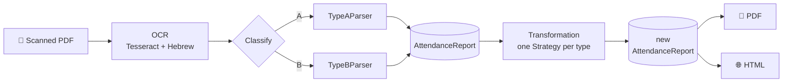

# 🕒 Attendance Report Variation Generator

🇬🇧 **English** · 🇮🇱 [עברית](README.he.md)


> Takes a **scanned attendance report**, reads it, changes the working hours so that
> the report still makes complete sense, and produces a new PDF with **exactly the same layout** as the original.

---

## ✨ What it does

<table>
<tr>
<td width="50%">

**In:** a scan (image only, no text) of a Hebrew attendance report, with noise, table lines, handwriting in the margins and a blacked-out name.

</td>
<td width="50%">

**Out:** a new PDF and HTML in the same layout, with different hours, and every total (hours, rate columns, pay) recomputed to match the rows.

</td>
</tr>
</table>

- 🔍 **Detects on its own** which report type it is (A or B).
- 🧠 **Repairs OCR errors** using the redundancy inside the report itself.
- 🎲 **Deterministic:** the same file with the same `seed` always gives the same output, byte for byte.
- ✅ **Every variation is checked** against a list of rules. If a rule breaks, no file is written.
- 🔒 **The source file is never modified.**

---

## 📄 The two report types

| | 🅰️ Type A: staffing agency report | 🅱️ Type B: monthly employee card |
|---|---|---|
| **Rows** | Only the days worked | Always 31 lines: every day of the month (weekends empty, Shabbat shaded); a short month continues into the first days of the next month |
| **Columns** | date · day · location · entry · exit · break · total · 100% · 125% · 150% · Shabbat | date · weekday · entry · exit · total hours · notes |
| **Totals** | A totals row + a summary box below the table | A box above the table: days, hours, hourly rate, amount to pay |
| **Format** | `02/10/2022` · `08:00` | `1/1/23` · `8:01` |
| **Kind of hours** | Round (08:00–15:00) | Clock punches (8:01–11:05) |

---

## ⚙️ How it works

The code is a **pipeline of stations**. Each station only knows what comes in and what goes out.



`AttendanceReport` is **the contract**: from this point on, no station knows which file or which OCR the data came from. It is a `frozen dataclass`, so the transformation has to build a new object and the source cannot be changed by mistake.

### 🧩 Design patterns

| Layer | Base class | Subclasses | Split by | Pattern |
|---|---|---|---|---|
| Parsing | `BaseParser` | `TypeAParser`, `TypeBParser` | report type | **Template Method** |
| Transformation | `BaseTransformationStrategy` | `TypeA…`, `TypeB…Strategy` | report type | **Strategy** |
| Generation | `BaseRenderer` | `PdfRenderer`, `HtmlRenderer` | output format | plain inheritance |

**Adding a type C?** A parser class, a strategy class and a page layout (data only), plus one line in each registry. The code of A and B is not touched.

---

## 🧠 Repairing OCR errors

OCR on a scan is never clean. But every report contains **redundant information**, and the code uses it:

| The error | How it is detected | How it is fixed |
|---|---|---|
| `3:02` instead of `8:02` | exit − entry ≠ total | Picks the fix that changes the fewest digits, among fixes that give a plausible row |
| `41:01` instead of `11:01` | Not a valid time | Recomputed from entry + total |
| `29/14/23`, `5/1123` | Not a valid date | In type B every day is printed at a fixed height, so the date comes from **the line's position on the page** (per page) |
| `כח אדם` read as `ND DTN`, `שבת` as `naw` | Latin letters in an all-Hebrew report | The word is read again on its own, with the Hebrew model only |
| `45.50` read as `0` | A number in a box far too wide for it | The number is read again on its own, with the English model (better at digits) |
| `01/02/2023` read as `3` | Not a valid date | In type A: the next date that matches the printed weekday |
| An unrecognised column title | A column is missing from the header row | Its position is computed from the neighbouring columns |
| Monthly hours `2` instead of `63.02` | hours × rate is nowhere near the pay | hours = pay ÷ rate |

Every fix is **reported as a warning**, never hidden. Tested on four real scans: every row is read correctly, and the pay computed from the hours that were read comes out exactly as printed.

---

## 🚀 Installation

Requires **Python 3.10 or newer**.

```bash
pip install -e ".[dev]"
```

On Windows, if `pip` is not recognised: `py -m pip install -e ".[dev]"`

### System tools (for OCR)

| System | Install |
|---|---|
| 🐧 Ubuntu / Debian | `sudo apt install tesseract-ocr tesseract-ocr-heb poppler-utils` |
| 🍎 macOS | `brew install tesseract tesseract-lang poppler` |
| 🪟 Windows | [Tesseract (UB Mannheim)](https://github.com/UB-Mannheim/tesseract/wiki) with **Hebrew**, and [Poppler](https://github.com/oschwartz10612/poppler-windows/releases). Add both `bin` folders to PATH |

Check: `tesseract --list-langs` should list `heb`.

### 🐳 Or with Docker, nothing to install

```bash
docker build -t attendance-report .
docker run --rm -v "$(pwd)/samples/input:/in" -v "$(pwd)/output:/out" \
    attendance-report /in/report.pdf -o /out
```

---

## ▶️ Usage

```bash
attendance-report path/to/report.pdf -o output/
```

| Option | Meaning |
|---|---|
| `-o DIR` | Output folder (default: `output`) |
| `--seed N` | A different variation. The same seed gives the same output |
| `--pdf-only` / `--html-only` | Only one output format |
| `--extract auto\|text\|ocr` | How to read the file (default: automatic) |
| `-v` | Detailed log: what was detected and which repairs were made |

**Example output:**
```
✓ report.pdf: TYPE_B, 31 rows -> output/report_variant.pdf, output/report_variant.html
✗ invoice.pdf: cannot tell the report type, scores={...}
```

Try it right away on the invented reports included in the repository:
```bash
attendance-report samples/synthetic/type_a_synthetic_scan.pdf samples/synthetic/type_b_synthetic_scan.pdf
```

**Exit codes:** `0` all good · `1` a problem with an input file (✗ is printed and the program moves on to the next file) · `2` a bug in the code.
**Multi-page reports** are read in full. A page that starts with the column titles again is joined to the table.

---

## 🎛️ Variation rules

| | 🅰️ Type A | 🅱️ Type B |
|---|---|---|
| Entry shift | ±30 min, in steps of 5 | ±8 min, in steps of 1 |
| Change in worked time | ±30 min | ±10 min |
| Daily range | 3–12 hours | 2–12 hours |
| Recomputed | total, 100/125/150/Shabbat, totals row, summary box | total, work days, monthly hours, amount to pay |
| Kept | dates, location, break, bonus, travel, **each day's pay category** (a holiday stays at 150%) | dates, empty days, notes, hourly rate |

All the numbers are in one file: [`transformation/rules.py`](src/attendance_report/transformation/rules.py).

---

## 🧪 Tests

```bash
pytest
```

**219 tests.** Most of them run for anyone, even **without Tesseract and without the private reports** (205 tests, in about a second):

- 🧪 **Invented reports as fixtures:** two reports with an invented company, employee and hours, drawn in the same layout, "scanned", and run through real OCR once. The result is saved in `tests/fixtures/`, together with OCR errors added on purpose, like the ones found in the real scans (`3:02` for `8:02`, a date read as `13`...). The parser has to rebuild the report from them **exactly**.
- 🔁 **Read back:** the parser reads the generated PDF and gets exactly the varied report.
- 📄 **Two pages:** a report split across two pages gives the same result as one page.
- 🎲 Every rule is checked on 150 seeds per type.
- 🚦 The CLI tells a bad input file apart from a bug.
- 🔒 The source is never modified, and two runs produce identical files.

> **📌 The real scans** belong to another person, so they are **not in the repository** (`samples/input/*.pdf` is in `.gitignore`).
> Whoever has them can put them in `samples/input/` as `type_a_scan.pdf`, `type_b_scan.pdf`,
> `type_a_scan_2.pdf`, `type_b_scan_2.pdf`; then the tests that check every value against the scan run too.
>
> **Rebuilding the fixtures** (needs Tesseract): `python -m tools.build_fixtures`

---

## 📁 Project structure

```
src/attendance_report/
├── domain/              # the contract: data model and rules
│   ├── models.py        #   AttendanceRow, AttendanceReport, ReportSummary
│   ├── validation.py    #   invariants
│   ├── exceptions.py    #   one error class per station, shared base
│   └── calendar_he.py   #   Hebrew day and month names
├── parsing/             # PDF -> object
│   ├── extraction.py    #   text layer or OCR, all pages
│   ├── ocr.py           #   Tesseract + grid-line erasing + second look
│   ├── classifier.py    #   report type detection
│   ├── base_parser.py   #   Template Method
│   ├── type_a_parser.py
│   ├── type_b_parser.py
│   ├── repair.py        #   OCR error repair
│   └── factory.py       #   type -> parser
├── transformation/      # changing the hours
│   ├── rules.py         #   every number, per type
│   ├── strategies.py    #   Strategy
│   └── service.py       #   the loop + rule checking
├── generation/          # object -> file
│   ├── layouts.py       #   geometry measured from the scans
│   ├── pdf_renderer.py  #   ReportLab + right-to-left Hebrew
│   └── html_renderer.py
├── pipeline.py          # the order of the stations ("table of contents")
└── cli.py               # the terminal: arguments, ✓/✗, exit codes
tests/
├── fixtures/            # OCR output of the invented reports + their true content
└── test_*.py
tools/
└── build_fixtures.py    # builds the fixtures (run once)
samples/
├── synthetic/           # the invented reports: digital PDF + "scan"
└── input/               # the real scans - not in the repository
```

---

## 📚 More

- **[DECISIONS.md](DECISIONS.md):** the decision log. For every decision: the options, the choice, and why. (Hebrew: [DECISIONS.he.md](DECISIONS.he.md))
- **Known limitations:** the output is a clean PDF, without scan noise or handwriting, and always a single page (even if the source was longer).

<div align="center">

Built with Python · Tesseract · OpenCV · ReportLab · pdfplumber

</div>
