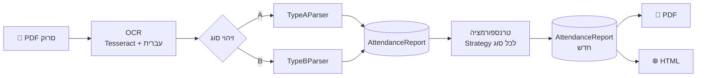

# 🕒 מחולל וריאציות לדו"ח נוכחות


> מקבל **דו"ח נוכחות סרוק**, קורא אותו, משנה את שעות העבודה כך שהדו"ח עדיין הגיוני לגמרי,
> ומפיק PDF חדש **באותו מבנה בדיוק** כמו המקור.

---

## ✨ מה הוא עושה

<table>
<tr>
<td width="50%">

**נכנס:** סריקה (תמונה בלבד, בלי טקסט) של דו"ח נוכחות בעברית, עם רעש, קווי טבלה, כתב יד בשוליים ושם מושחר.

</td>
<td width="50%">

**יוצא:** PDF ו-HTML חדשים באותה פריסה, עם שעות אחרות, וכל הסיכומים (שעות, אחוזים, שכר) מחושבים מחדש ומתאימים לשורות.

</td>
</tr>
</table>

- 🔍 **מזהה לבד** איזה סוג דו"ח זה (A או B).
- 🧠 **מתקן שגיאות OCR** בעזרת המידע הכפול שבדו"ח עצמו.
- 🎲 **דטרמיניסטי:** אותו קובץ ואותו `seed` נותנים תמיד אותו פלט, עד הבייט.
- ✅ **כל וריאציה נבדקת** מול רשימת כללים. אם כלל נשבר, לא נכתב קובץ.
- 🔒 **קובץ המקור לא משתנה אף פעם.**

---

## 📄 שני סוגי הדוחות

| | 🅰️ סוג A: דו"ח חברת כוח אדם | 🅱️ סוג B: כרטיס עובד חודשי |
|---|---|---|
| **שורות** | רק ימים שעבדו בהם | תמיד 31 שורות: כל ימי החודש (סופ"ש ריקים, שבת מוצללת), ובחודש קצר ממשיכים לימים הראשונים של החודש הבא |
| **עמודות** | תאריך · יום · מקום · כניסה · יציאה · הפסקה · סה"כ · 100% · 125% · 150% · שבת | תאריך · יום בשבוע · כניסה · יציאה · סה"כ שעות · הערות |
| **סיכומים** | שורת סה"כ + תיבת סיכום מתחת לטבלה | תיבה מעל הטבלה: ימים, שעות, מחיר לשעה, לתשלום |
| **פורמט** | `02/10/2022` · `08:00` | `1/1/23` · `8:01` |
| **אופי השעות** | עגולות (08:00–15:00) | החתמות שעון (8:01–11:05) |

---

## ⚙️ איך זה עובד

הקוד בנוי כ**צינור של שלבים**. כל שלב מכיר רק את מה שנכנס אליו ואת מה שיוצא ממנו.



`AttendanceReport` הוא **החוזה**: מהנקודה הזו אף שלב לא יודע מאיזה קובץ או מאיזה OCR הנתונים הגיעו. הוא מוגדר כ-`frozen dataclass`, כך שהטרנספורמציה חייבת לבנות אובייקט חדש, והמקור לא יכול להשתנות בטעות.

### 🧩 תבניות עיצוב

| שכבה | מחלקת בסיס | יורשים | מפצלים לפי | תבנית |
|---|---|---|---|---|
| פרסור | `BaseParser` | `TypeAParser`, `TypeBParser` | סוג הדו"ח | **Template Method** |
| טרנספורמציה | `BaseTransformationStrategy` | `TypeA…`, `TypeB…Strategy` | סוג הדו"ח | **Strategy** |
| גנרוט | `BaseRenderer` | `PdfRenderer`, `HtmlRenderer` | פורמט הפלט | ירושה פשוטה |

**הוספת סוג C?** מחלקת פרסר, מחלקת אסטרטגיה והגדרת פריסה (נתונים בלבד), ושורה אחת בכל רישום. לא נוגעים בקוד של A או B.

---

## 🧠 תיקון שגיאות OCR

OCR על סריקה אף פעם לא נקי. אבל בכל דו"ח יש **מידע כפול**, ובו הקוד משתמש:

| השגיאה | איך זה מתגלה | איך זה מתוקן |
|---|---|---|
| `3:02` במקום `8:02` | יציאה פחות כניסה לא שווה לסה"כ | הקוד בוחר את התיקון שדורש הכי מעט שינוי בספרות, מבין התיקונים שנותנים שורה סבירה |
| `41:01` במקום `11:01` | זו לא שעה חוקית | השעה מחושבת מחדש מכניסה + סה"כ |
| `29/14/23`, `5/1123` | תאריך לא חוקי | בסוג B כל הימים מודפסים בגובה קבוע, אז התאריך נקבע לפי **המיקום של השורה בעמוד** (לכל עמוד בנפרד) |
| `כח אדם` נקרא `ND DTN`, `שבת` נקרא `naw` | מילה באותיות לטיניות, בדו"ח שכולו עברית | המילה נקראת שוב לבד, עם מודל העברית בלבד |
| `45.50` נקרא `0` | מספר בתיבה רחבה מדי בשבילו | המספר נקרא שוב לבד, עם מודל האנגלית (הטוב בספרות) |
| `01/02/2023` נקרא `3` | תאריך לא חוקי | בסוג A: התאריך הבא שמתאים ליום בשבוע המודפס |
| כותרת עמודה שלא זוהתה | חסרה עמודה בשורת הכותרות | המיקום שלה מחושב מהעמודות השכנות |
| שעות חודשיות `2` במקום `63.02` | שעות × מחיר לשעה לא קרוב לשכר | שעות = שכר ÷ מחיר לשעה |

כל תיקון **מדווח כאזהרה** ולא מוסתר. נבדק על ארבע סריקות אמיתיות: כל השורות נקראות נכון, והשכר שמחושב מהשעות שנקראו יוצא בדיוק כמו שמודפס.

---

## 🚀 התקנה

דרוש **Python 3.10 ומעלה**.

```bash
pip install -e ".[dev]"
```

ב-Windows, אם `pip` לא מזוהה: `py -m pip install -e ".[dev]"`

### תוכנות מערכת (בשביל OCR)

| מערכת | התקנה |
|---|---|
| 🐧 Ubuntu / Debian | `sudo apt install tesseract-ocr tesseract-ocr-heb poppler-utils` |
| 🍎 macOS | `brew install tesseract tesseract-lang poppler` |
| 🪟 Windows | [Tesseract (UB Mannheim)](https://github.com/UB-Mannheim/tesseract/wiki) עם **Hebrew**, ו-[Poppler](https://github.com/oschwartz10612/poppler-windows/releases). את שתי תיקיות ה-`bin` מוסיפים ל-PATH |

בדיקה: `tesseract --list-langs` צריך להציג `heb`.

### 🐳 או עם Docker, בלי להתקין כלום

```bash
docker build -t attendance-report .
docker run --rm -v "$(pwd)/samples/input:/in" -v "$(pwd)/output:/out" \
    attendance-report /in/report.pdf -o /out
```

---

## ▶️ שימוש

```bash
attendance-report path/to/report.pdf -o output/
```

| אפשרות | משמעות |
|---|---|
| `-o DIR` | תיקיית הפלט (ברירת מחדל: `output`) |
| `--seed N` | וריאציה אחרת. אותו seed נותן אותו פלט |
| `--pdf-only` / `--html-only` | פורמט פלט אחד בלבד |
| `--extract auto\|text\|ocr` | איך לקרוא את הקובץ (ברירת מחדל: אוטומטי) |
| `-v` | לוג מפורט: מה זוהה ואילו תיקונים בוצעו |

**דוגמת פלט:**
```
✓ report.pdf: TYPE_B, 31 rows -> output/report_variant.pdf, output/report_variant.html
✗ invoice.pdf: cannot tell the report type, scores={...}
```

אפשר לנסות מיד על הדוחות המומצאים שבמאגר:
```bash
attendance-report samples/synthetic/type_a_synthetic_scan.pdf samples/synthetic/type_b_synthetic_scan.pdf
```

**קודי יציאה:** `0` הכל תקין · `1` קובץ קלט בעייתי (מודפס ✗ והתוכנית ממשיכה לקובץ הבא) · `2` באג בקוד.
**דוחות של כמה עמודים** נקראים במלואם. עמוד שמתחיל שוב בשורת הכותרות מצטרף לטבלה.

---

## 🎛️ כללי השינוי

| | 🅰️ סוג A | 🅱️ סוג B |
|---|---|---|
| הזזת כניסה | ±30 דק', בצעדים של 5 | ±8 דק', בצעדים של דקה |
| שינוי זמן העבודה | ±30 דק' | ±10 דק' |
| טווח יומי | 3–12 שעות | 2–12 שעות |
| מחושב מחדש | סה"כ, 100/125/150/שבת, שורת סה"כ, תיבת סיכום | סה"כ, ימי עבודה, שעות חודשיות, לתשלום |
| נשמר | תאריכים, מקום, הפסקה, בונוס, נסיעות, **סוג התעריף של כל יום** (חג נשאר 150%) | תאריכים, ימים ריקים, הערות, מחיר לשעה |

כל הערכים נמצאים בקובץ אחד: [`transformation/rules.py`](src/attendance_report/transformation/rules.py).

---

## 🧪 בדיקות

```bash
pytest
```

**219 בדיקות.** רובן רצות אצל כל אחד, גם **בלי Tesseract ובלי הדוחות הפרטיים** (205 בדיקות, תוך שנייה):

- 🧪 **דוחות מומצאים כ-fixtures:** שני דוחות עם חברה, עובד ושעות מומצאים, ששורטטו באותו מבנה, "נסרקו", ועברו OCR אמיתי פעם אחת. התוצאה שמורה ב-`tests/fixtures/`, יחד עם שגיאות OCR שהוכנסו בכוונה כמו שנמצאו בסריקות (`3:02` במקום `8:02`, תאריך שנקרא `13`...). הפרסר צריך לשחזר מהם את הדו"ח **בדיוק**.
- 🔁 **קריאה חוזרת:** הפרסר קורא את ה-PDF שנוצר ומקבל בדיוק את הדו"ח אחרי השינוי.
- 📄 **שני עמודים:** דו"ח שמפוצל לשני עמודים נותן את אותה תוצאה כמו עמוד אחד.
- 🎲 כל הכללים נבדקים על 150 ערכי seed לכל סוג.
- 🚦 ה-CLI מבדיל בין קובץ בעייתי לבין באג.
- 🔒 המקור לא משתנה, ושתי הרצות נותנות קבצים זהים.

> **📌 הסריקות האמיתיות** הן של אדם אחר, ולכן **לא כלולות במאגר** (`samples/input/*.pdf` ב-`.gitignore`).
> מי שיש לו אותן שם אותן ב-`samples/input/` בשמות `type_a_scan.pdf`, `type_b_scan.pdf`,
> `type_a_scan_2.pdf`, `type_b_scan_2.pdf`, ואז רצות גם הבדיקות שמשוות מול כל ערך בסריקה.
>
> **בניית ה-fixtures מחדש** (צריך Tesseract): `python -m tools.build_fixtures`

---

## 📁 מבנה הפרויקט

```
src/attendance_report/
├── domain/              # החוזה: מודל הנתונים והכללים
│   ├── models.py        #   AttendanceRow, AttendanceReport, ReportSummary
│   ├── validation.py    #   אינווריאנטים
│   ├── exceptions.py    #   מחלקת שגיאה לכל תחנה, ובסיס משותף
│   └── calendar_he.py   #   שמות ימים וחודשים בעברית
├── parsing/             # מ-PDF לאובייקט
│   ├── extraction.py    #   שכבת טקסט או OCR, כל העמודים
│   ├── ocr.py           #   Tesseract + מחיקת קווי טבלה + קריאה שנייה
│   ├── classifier.py    #   זיהוי סוג
│   ├── base_parser.py   #   Template Method
│   ├── type_a_parser.py
│   ├── type_b_parser.py
│   ├── repair.py        #   תיקון שגיאות OCR
│   └── factory.py       #   סוג -> פרסר
├── transformation/      # משנים שעות
│   ├── rules.py         #   כל המספרים, לכל סוג
│   ├── strategies.py    #   Strategy
│   └── service.py       #   הלולאה + בדיקת כללים
├── generation/          # מאובייקט לקובץ
│   ├── layouts.py       #   מידות שנמדדו מהסריקות
│   ├── pdf_renderer.py  #   ReportLab + עברית מימין לשמאל
│   └── html_renderer.py
├── pipeline.py          # סדר התחנות ("תוכן העניינים")
└── cli.py               # הטרמינל: ארגומנטים, ✓/✗, קודי יציאה
tests/
├── fixtures/            # פלט OCR של הדוחות המומצאים + הדו"ח האמיתי שלהם
└── test_*.py
tools/
└── build_fixtures.py    # בונה את ה-fixtures (פעם אחת)
samples/
├── synthetic/           # הדוחות המומצאים: PDF דיגיטלי + "סריקה"
└── input/               # הסריקות האמיתיות - לא במאגר
```

---

## 📚 עוד

- **[DECISIONS.md](DECISIONS.md):** יומן ההחלטות. לכל החלטה: מה היו האפשרויות, מה נבחר ולמה.
- **מגבלות ידועות:** הפלט הוא PDF נקי, בלי רעש סריקה וכתב יד, ותמיד עמוד אחד (גם אם המקור היה ארוך יותר).

<div align="center">

נבנה ב-Python · Tesseract · OpenCV · ReportLab · pdfplumber

</div>
